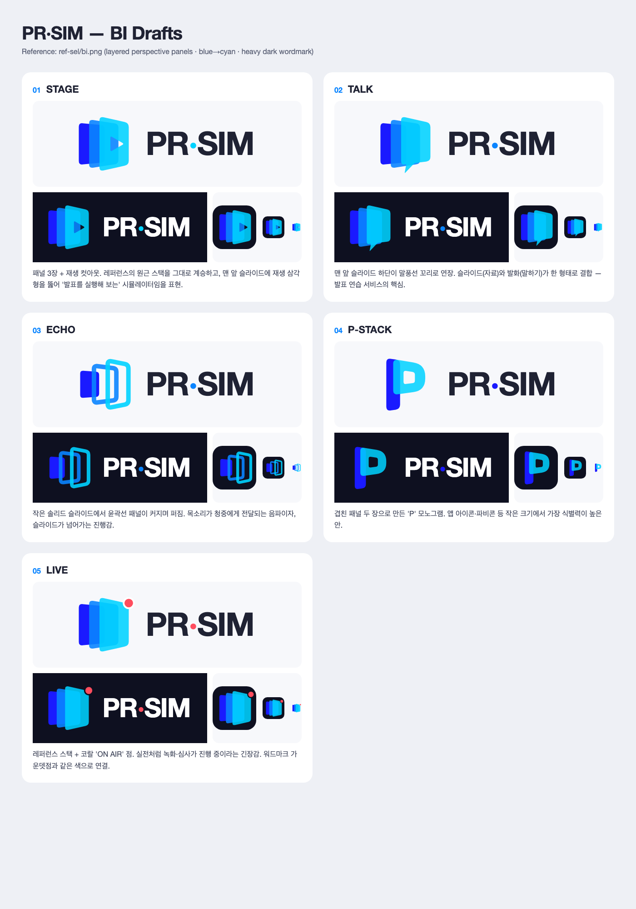

# PR·SIM BI 시안 5종

레퍼런스: [`../ref-sel/bi.png`](../ref-sel/bi.png)에서 가져온 요소는 **원근감 있게 겹친 둥근 패널 3장**, **블루→시안 반투명 그러데이션**, **굵은 다크 산세리프 워드마크**입니다. 다섯 시안 모두 이 DNA를 유지하면서 심볼에 담은 의미를 다르게 했습니다.



| # | 이름 | 콘셉트 | 강점 |
|---|------|--------|------|
| 01 | **STAGE** | 맨 앞 슬라이드에 재생(▶) 컷아웃 | 레퍼런스와 가장 가깝고, '시뮬레이션 실행'이 직관적 |
| 02 | **TALK** | 맨 앞 슬라이드 하단이 말풍선 꼬리로 연장 | 자료와 발화를 한 형태에 담음. 서비스 정체성이 가장 명확 |
| 03 | **ECHO** | 솔리드 슬라이드에서 윤곽 패널이 퍼져 나감 | 음성 전달과 진행감을 표현. 가볍고 기술적인 인상 |
| 04 | **P-STACK** | 겹친 패널 두 장으로 만든 P 모노그램 | 앱 아이콘·파비콘처럼 작은 크기에서 식별력이 가장 높음 |
| 05 | **LIVE** | 레퍼런스 스택에 코랄 ON AIR 점 추가 | 실전 녹화·심사 중이라는 긴장감. 워드마크 가운뎃점과 같은 색으로 연결 |

## 컬러

| 역할 | HEX |
|------|-----|
| Deep Blue | `#1A1AFF` |
| Mid Blue | `#0A84FF` |
| Cyan | `#00D2FF` |
| Ink(워드마크) | `#1F2233` |
| Dark BG | `#0E1020` |
| Live Accent(05) | `#FF4D5E` |

## 파일 구성

각 시안 폴더(`01-stage/` … `05-live/`)에는 아래 파일이 있습니다. 모두 SVG 원본과 PNG 렌더링이 함께 들어 있습니다.

- `symbol` — 심볼 단독(투명 배경, 400×400)
- `app-icon` — 다크 라운드 타일 위 심볼(400×400)
- `lockup` — 심볼 + 워드마크 가로형(1000×400)
- `lockup-dark` — 다크 배경 가로형

전체 비교는 `index.html`(브라우저)과 `overview.png`에서 볼 수 있습니다.

## 재생성

```bash
cd docs/bi && python3 draft/_generate.py draft
```

## 참고

- 워드마크는 SVG `<text>`로 작성했습니다(Pretendard → Inter → SF Pro → Helvetica 순으로 대체). 확정 단계에서는 폰트를 정하고 아웃라인으로 변환해야 합니다.
- 각 시안은 레퍼런스의 형태 원리를 참고해 새로 그린 초안입니다. 원작 로고의 형태를 그대로 옮기지 않았습니다.
