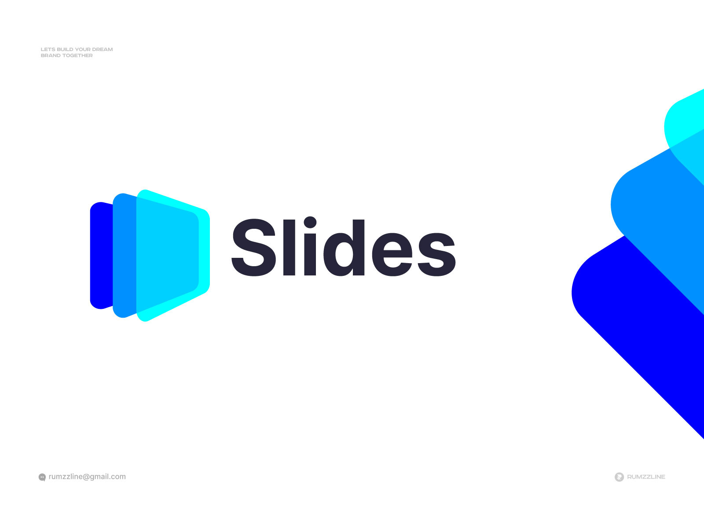
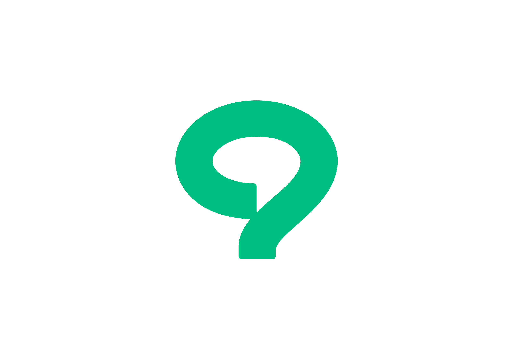
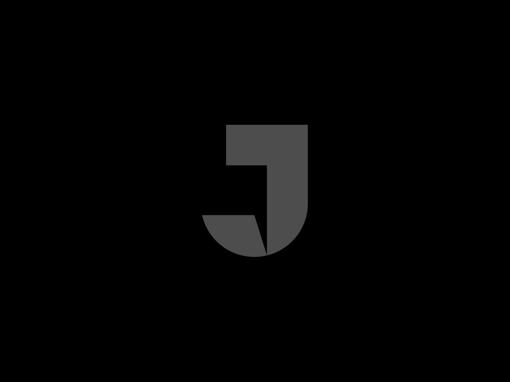
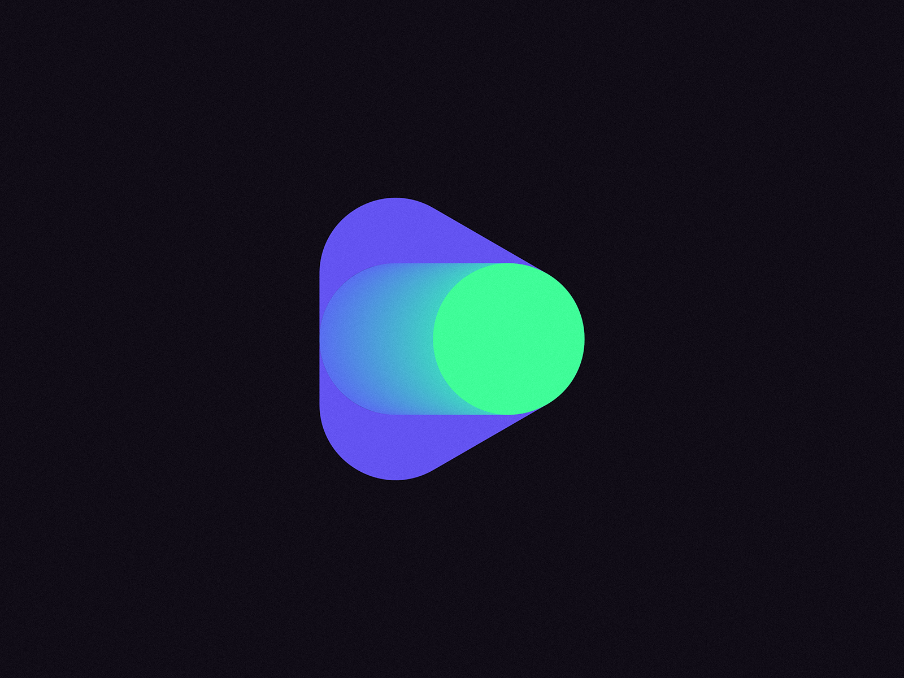
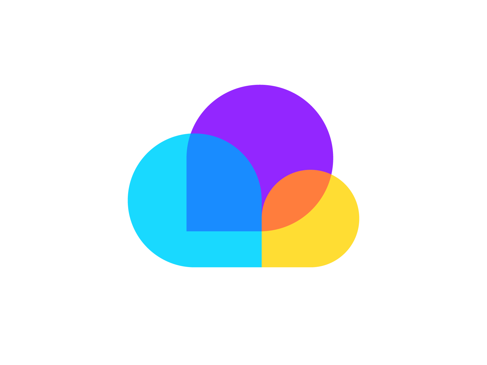
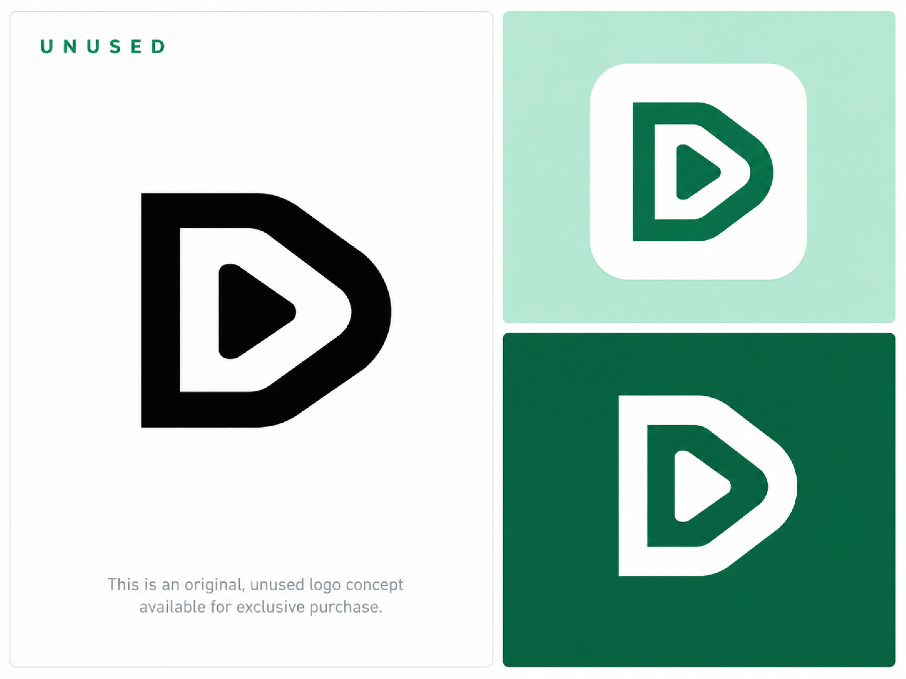
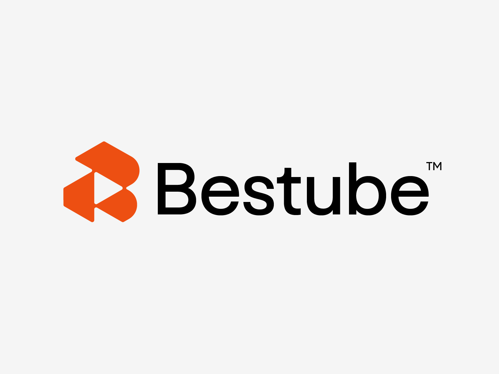
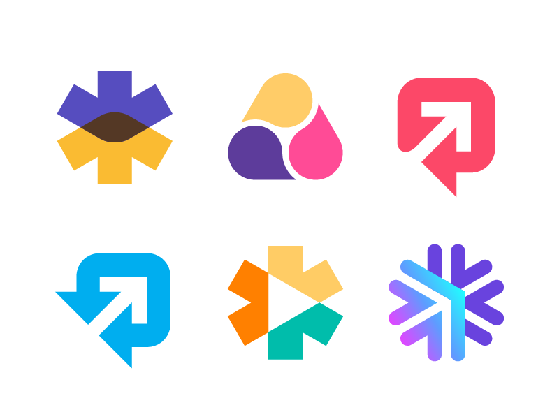
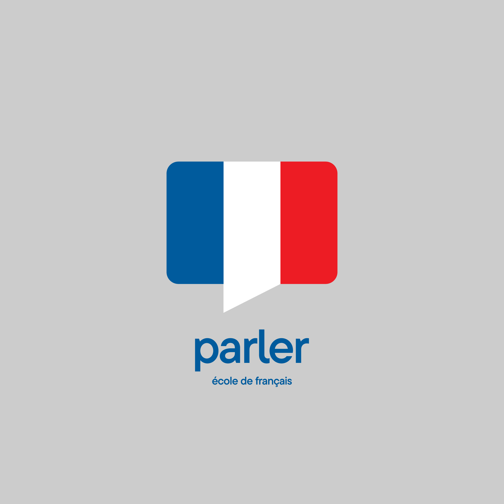

# PR-SIM 로고 레퍼런스 — Dribbble 10선

발표 상황을 재현하는 프리젠테이션 시뮬레이터 웹앱을 위한 BI 참고 자료. 수집일: 2026-11-12.

## 선정 기준

- 심볼이 원, 삼각형, 사각형, 캡슐, 원호 또는 단순 다각형과 여백으로 구성될 것.
- 발표 자료, 발화, 연습 시작, 모의 질문, 피드백 중 하나 이상을 연상시킬 것.
- 일러스트·캐릭터·장식적 워드마크 중심 작품을 제외하고, 별도 텍스트 없이도 성립하는 심볼을 고를 것.
- 작품 간 유사한 심볼과 동일 작품의 응용 이미지는 중복 선정하지 않을 것.

설명에 적힌 PR-SIM과의 연결 및 적합도는 시각적으로 검토한 큐레이션 판단이다. 첨부 이미지는 Dribbble 공개 CDN에서 받은 참고 이미지이며, 워드마크·설명·탐색 시트가 포함된 경우에도 선정 대상은 설명에 명시한 도형 심볼이다.

## 빠르게 보기

- [10개 비교 이미지](./overview.jpg)
- [브라우저 갤러리](./index.html)
- [출처 및 파일 정보 JSON](./sources.json)

우선 검토: **01 Slides**(발표 자료), **02 Question + Bubble**(모의 질문), **03 Play + Flag**(연습 시작), **05 Play + Toggle**(실행 상태), **09 Wip의 말풍선+화살표**(피드백·향상).

## 후보 목록

### 01. Slide Logo - Software App Logo - Brand Identity

- 원작자: Ahmed Rumon
- 원본: [Slide Logo - Software App Logo - Brand Identity](https://dribbble.com/shots/18014336-Slide-Logo-Software-App-Logo-Brand-Identity)
- 분류 / PR-SIM 적합도: 슬라이드 / 높음
- 선정 이유: 둥근 사각 패널 3장이 겹치는 구조. 발표 자료와 화면 전환을 직접 연상시켜 서비스 주제와 가장 가깝다.
- 참고 포인트: 패널 수, 간격, 겹침만으로 심볼을 구성하는 방식. 워드마크를 제외한 왼쪽 심볼을 참고.
- 저장 파일: [01-slide.jpg](./01-slide.jpg) · 1600 × 1200

### 02. В.Опрос — survey service. Question + Bubble speech.

- 원작자: Anton Akhmatov
- 원본: [В.Опрос — survey service. Question + Bubble speech.](https://dribbble.com/shots/25240361--survey-service-Question-Bubble-speech)
- 분류 / PR-SIM 적합도: 질문·피드백 / 높음
- 선정 이유: 곡선으로 이루어진 물음표와 말풍선의 여백을 결합한 단색 심볼. 모의 심사 질문과 피드백 기능에 연결하기 좋다.
- 참고 포인트: 실루엣 하나에 질문과 발화의 의미를 함께 담는 네거티브 스페이스.
- 저장 파일: [02-question.png](./02-question.png) · 3201 × 2161

### 03. Play button and flag symbol logo

- 원작자: Viktor Snopčok
- 원본: [Play button and flag symbol logo](https://dribbble.com/shots/27374420-Play-button-and-flag-symbol-logo)
- 분류 / PR-SIM 적합도: 연습 시작·목표 / 높음
- 선정 이유: 가는 막대, 사선 사각형, 삼각형의 조합. 재생 버튼과 깃발을 동시에 읽을 수 있어 연습 시작과 목표 달성을 연상시킨다.
- 참고 포인트: 기울기와 도형 사이 간격으로 방향성을 만드는 방식.
- 저장 파일: [03-flag.png](./03-flag.png) · 1600 × 1200

### 04. J T speech bubble symbol logo

- 원작자: Viktor Snopčok
- 원본: [J T speech bubble symbol logo](https://dribbble.com/shots/27372804-J-T-speech-bubble-symbol-logo)
- 분류 / PR-SIM 적합도: 발화·소통 / 보통
- 선정 이유: 직사각형과 둥근 하단을 결합한 단색 기하 심볼. 내부의 삼각형 여백으로 말풍선의 꼬리를 암시한다.
- 참고 포인트: 문자 자체보다 직선·곡선·삼각 여백이 결합하는 원리를 참고.
- 저장 파일: [04-jt.png](./04-jt.png) · 1600 × 1200

### 05. Play Button and Toggle Switch Logo Concept

- 원작자: Dmitry Lepisov / Lepisov Branding
- 원본: [Play Button and Toggle Switch Logo Concept](https://dribbble.com/shots/24487404-Play-Button-and-Toggle-Switch-Logo-Concept)
- 분류 / PR-SIM 적합도: 시뮬레이션 시작 / 높음
- 선정 이유: 둥근 삼각형, 캡슐, 원이 결합한 심볼. 재생과 상태 전환을 함께 연상시켜 시뮬레이터의 실행 동작과 연결된다.
- 참고 포인트: 기본 도형을 겹쳐 두 가지 의미를 만드는 방식. 원본에는 그라데이션이 있으므로 형태 중심으로 참고.
- 저장 파일: [05-toggle.png](./05-toggle.png) · 1600 × 1200

### 06. Logo Concept: Cloud & Speech Bubbles

- 원작자: Kakha Kakhadzen
- 원본: [Logo Concept: Cloud & Speech Bubbles](https://dribbble.com/shots/21473406-Logo-Concept-Cloud-Speech-Bubbles)
- 분류 / PR-SIM 적합도: 대화·청중 / 보통
- 선정 이유: 둥근 사각형과 원호 형태를 겹친 평면 심볼. 여러 화자의 대화나 청중과의 상호작용을 연상시킨다.
- 참고 포인트: 같은 계열의 둥근 도형을 크기와 색만 바꿔 조합하는 방식.
- 저장 파일: [06-cloud.png](./06-cloud.png) · 1600 × 1200

### 07. Entertainment Unused Geometric Play Button Logo Concept

- 원작자: ABIDA SULTANA NISA / LOGOHAUS
- 원본: [Entertainment Unused Geometric Play Button Logo Concept](https://dribbble.com/shots/27812512-Entertainment-Unused-Geometric-Play-Button-Logo-Concept)
- 분류 / PR-SIM 적합도: 실행·화면 / 보통
- 선정 이유: 둥근 D형 외곽과 안쪽 삼각형이 결합한 평면 심볼. 단색 버전에서도 재생의 의미가 분명하다.
- 참고 포인트: 외곽 프레임과 내부 도형의 간격, 단색 실루엣.
- 저장 파일: [07-geometric-play.jpg](./07-geometric-play.jpg) · 3620 × 2715

### 08. B Logo, Tube logo, Play button logo

- 원작자: Zikospace
- 원본: [B Logo, Tube logo, Play button logo](https://dribbble.com/shots/27624328-B-Logo-Tube-logo-Play-button-logo)
- 분류 / PR-SIM 적합도: 반복 연습·재생 / 보통
- 선정 이유: 각진 다각형 두 개와 삼각형 여백으로 구성된 심볼. 텍스트 없이도 방향성이 드러난다.
- 참고 포인트: 서로 맞물리는 도형과 중앙 여백의 균형. 워드마크를 제외한 왼쪽 심볼을 참고.
- 저장 파일: [08-b-play.png](./08-b-play.png) · 1600 × 1200

### 09. Wip

- 원작자: Kakha Kakhadzen
- 원본: [Wip](https://dribbble.com/shots/6703736-Wip)
- 분류 / PR-SIM 적합도: 발화·성장 / 높음
- 선정 이유: 여섯 가지 심볼 탐색 중 오른쪽 위와 왼쪽 아래의 말풍선+대각 화살표를 선정. 둥근 사각형과 화살표 여백으로 표현된다.
- 참고 포인트: 발표 후 향상과 피드백을 말풍선에 결합하는 방식. 원본 탐색 시트를 그대로 보존.
- 저장 파일: [09-arrows.png](./09-arrows.png) · 800 × 600

### 10. Parler - School of French

- 원작자: Goce Veleski
- 원본: [Parler - School of French](https://dribbble.com/shots/26087937-Parler-School-of-French)
- 분류 / PR-SIM 적합도: 발표·언어 연습 / 보통
- 선정 이유: 가로 직사각형을 세로 패널로 나누고 가운데 패널을 말풍선 꼬리처럼 연장한 구조. 단순한 면 분할로 발화를 표현한다.
- 참고 포인트: 사각 패널에 꼬리 하나만 더해 의미를 만드는 방식. 국기 색과 워드마크보다 상단 심볼의 구조를 참고.
- 저장 파일: [10-parler.png](./10-parler.png) · 2250 × 2250

## 출처와 사용 범위

원작 로고와 이미지는 각 원작자의 작업물이며 디자인 방향을 비교하기 위한 참고 자료로 보관한다. 다운로드는 로고의 사용권이나 독점권 취득을 의미하지 않는다. 실제 PR-SIM 로고는 이 자료의 형태 원리를 참고해 별도로 디자인한다.
