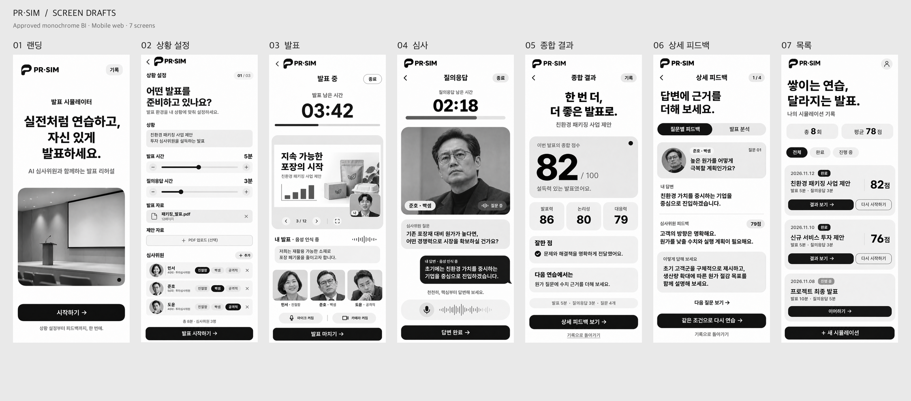

# PR-SIM 화면 시안

Oppie 레퍼런스의 흑백·라운드 카드·넓은 여백을 적용한 모바일 웹앱 시안 7종입니다. 프로젝트 `assets/bi/`의 확정 검정 P 심볼·PR·SIM 로고를 전체 화면의 왼쪽 상단에 적용했습니다.

| 화면 | 이미지 |
|---|---|
| 01 · 랜딩 | [01-landing.png](./01-landing.png) |
| 02 · 상황 설정 | [02-setup.png](./02-setup.png) |
| 03 · 발표 | [03-presentation.png](./03-presentation.png) |
| 04 · 심사 / 질의응답 | [04-review.png](./04-review.png) |
| 05 · 종합 결과 | [05-results.png](./05-results.png) |
| 06 · 상세 피드백 | [06-feedback.png](./06-feedback.png) |
| 07 · 기록 목록 | [07-history.png](./07-history.png) |

요청의 화면 목록은 6종이므로 결과를 종합 결과와 상세 피드백으로 나누어 총 7종으로 구성했습니다. 손그림 스케치의 세로 구성을 따라 모바일 우선으로 디자인했습니다. 긴 화면은 전체 구성을 보여 주며 실제 웹 구현에서는 본문을 스크롤합니다.

- [DESIGN.md](./DESIGN.md): 레퍼런스 분석, 색상·서체·간격 토큰, 컴포넌트, 화면 흐름, 반응형과 상호작용 규칙.
- [prompts.json](./prompts.json): 내장 image_gen에 사용한 화면별 프롬프트와 참조 이미지 목록.
- [manifest.json](./manifest.json): 이미지 크기·파일명·생성 방식.

이미지는 내장 image_gen으로 생성한 검토용 시안이며, 사진 속 인물·평가·기록은 예시입니다. 실제 구현의 한글 라벨과 조작 규칙은 DESIGN.md를 기준으로 확인합니다. overview.png는 개별 PNG를 수정하지 않고 축소해 배열한 비교 이미지입니다.

기존 컬러 로고 시안과 수정 전 생성 기록은 `archive/pre-approved-bi/`에 보관했습니다.
