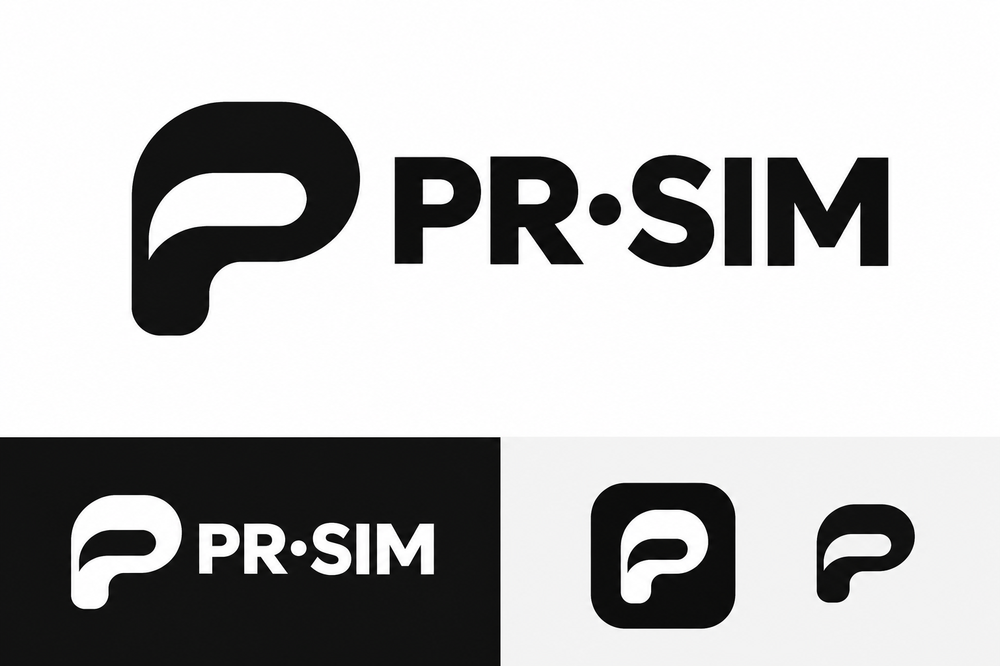

# PR·SIM 브랜드 아이덴티티

**상태: 최종 시안 확정.** 사용자가 선택한 [Monochrome 보드](../bi/monochrome/identity-board.png)를 브랜드의 기준으로 사용합니다.

## 형태와 의미

굵고 둥근 P형 단일 심볼과 산세리프 `PR·SIM` 워드마크를 조합합니다. 심볼 안쪽의 휘어진 여백은 발화와 반복 연습의 흐름을 표현합니다. 부드러운 모서리, 넓은 여백, 강한 흑백 대비가 핵심입니다. 이 흑백 기준은 브랜드와 UI 요소에 적용합니다. 심사위원 사진·발표자 카메라·발표 슬라이드는 컬러로 표시하며, 자료의 원본 색상을 보존합니다.

기존 Slides 레퍼런스의 겹친 패널·원근·블루/시안은 최종 형태에 사용하지 않습니다. 새 실루엣과 흑백 조합을 사용합니다.

## 색상과 화면 적용

| 역할 | 기준 색상 |
|---|---|
| 심볼·워드마크·주요 잉크 | `#111111` |
| 기본 배경·반전 로고 | `#FFFFFF` |
| 보조 적용 면 | `#F5F5F5` |

밝은 화면에는 검정 로고, 검은 화면에는 흰색 로고를 사용합니다. 작은 앱 진입점에는 검은 라운드 타일의 흰 심볼을 사용합니다. 로고 주변에는 심볼 너비의 약 1/4 이상 여백을 권장합니다. 가로세로 비율을 유지하며, 작은 크기에서는 심볼 안쪽 여백이 막히지 않는지 확인합니다.

로고에 색상·그라데이션·그림자·추가 윤곽선을 넣거나, 심볼과 워드마크를 임의로 늘이거나 변형하지 않습니다.

이 결정은 [화면 디자인 문서](../screens/draft/DESIGN.md)의 임시 STAGE 심볼 및 브랜드 블루/시안 규정을 대체합니다. 화면 문서의 다른 UI 토큰은 해당 문서를 따릅니다.

## 확정 에셋

모든 파일은 [`assets/bi`](../../assets/bi/)에 있습니다.

| 파일 | 용도 |
|---|---|
| [identity-board.png](../../assets/bi/identity-board.png) | 확정 보드 원본 사본 |
| [lockup-light.png](../../assets/bi/lockup-light.png) | 흰 배경을 포함한 기본 가로 로고 |
| [lockup-dark.png](../../assets/bi/lockup-dark.png) | 검은 배경을 포함한 보드의 반전 가로 로고 |
| [lockup-black.png](../../assets/bi/lockup-black.png) / [lockup-white.png](../../assets/bi/lockup-white.png) | 투명 배경 가로 로고 |
| [symbol-black.png](../../assets/bi/symbol-black.png) / [symbol-white.png](../../assets/bi/symbol-white.png) | 투명 배경 심볼 단독 |
| [wordmark-black.png](../../assets/bi/wordmark-black.png) / [wordmark-white.png](../../assets/bi/wordmark-white.png) | 투명 배경 워드마크 단독 |
| [app-icon.png](../../assets/bi/app-icon.png) | 보드에서 분리한 앱 아이콘, 타일 바깥 투명 |

## 원본과 분할 방식

이번 에셋은 확정 보드의 픽셀을 직접 분할한 PNG입니다. 별도 생성했던 `docs/bi/monochrome/symbol-transparent.png`는 원본과 미세한 형태 차이가 있을 수 있어 최종 에셋의 출처로 사용하지 않습니다.

배경 포함 로고는 원본 픽셀을 보존합니다. 투명 배경 파일은 기본형에서 배경을 제거하고 잉크 색을 균일하게 정리했으며, 흰색 버전도 같은 윤곽에서 파생했습니다. 따라서 생성 보드의 반전 예시와 투명 흰색 파일 사이에는 미세한 윤곽 차이가 있을 수 있습니다. 벡터 원본은 없으며 PNG를 SVG로 감싼 파일을 벡터로 제공하지 않습니다.

분할 좌표·크기·처리는 [manifest.json](../../assets/bi/manifest.json)에 기록합니다. Pillow가 설치된 환경에서 프로젝트 루트에서 `python3 assets/bi/extract.py`로 재현할 수 있습니다.

